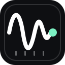
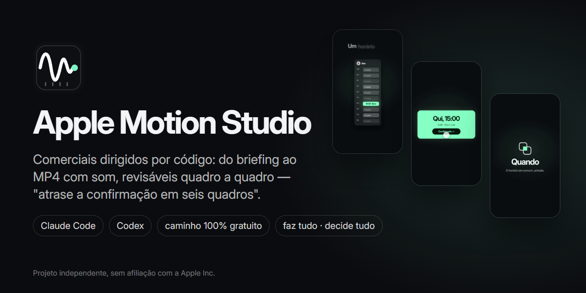
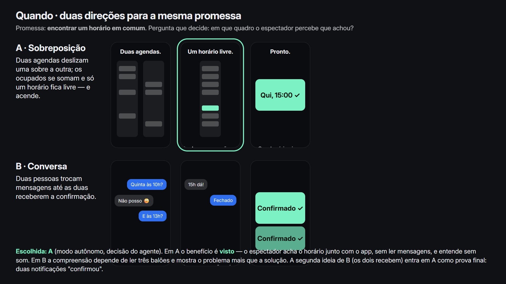

<p align="center"></p>

<h1 align="center">Apple Motion Studio</h1>

<p align="center"><b>Comerciais dirigidos por código para Claude Code e Codex.</b> Do briefing ao MP4 com som, e cada nota vira uma mudança localizada:<br>
"atrase a confirmação em seis quadros", "deixe esse som menos estridente", "troque a foto deste perfil".</p>

<p align="center"></p>

> Projeto independente, **sem afiliação com a Apple Inc.** "Apple" no nome indica a referência de estilo dos filmes de
> lançamento (precisão, materialidade, tipografia, som). A skill nunca usa logotipo, fontes, sons ou textos da Apple.

## O que a skill faz

É uma *skill* (pasta de instruções e scripts) que ensina o agente a produzir motion graphics no estilo de filmes de
lançamento, **sem gerador de vídeo por IA**. Cada quadro é uma função do tempo (`renderAt(t)`), renderizada em Chrome headless
e codificada com FFmpeg em MP4 de 1080p ou 4K, 16:9 ou 9:16, até 60 fps. O fluxo completo:

- **Briefing e storyboard.** Duas tiras com premissas diferentes quando o roteiro admite soluções diferentes. A direção
  escolhida diz em qual quadro o espectador entende a promessa.
- **Animação.** DOM/CSS para interfaces, Canvas, Three.js para geometria real, Blender para produto fotorrealista. Física de
  mola única (`duration`/`bounce`), câmera contínua e texto palavra por palavra.
- **Som.** Eventos sonoros amarrados aos eventos visuais (`window.EVENTS`), música escolhida por licença antes de gosto, stems
  separados, true peak medido no MP4 decodificado e checagem de mono.
- **Portões automáticos.** Foto obrigatória ausente, corrompida ou não ligada à vaga bloqueia o master. Exceções de JS, 404,
  quadros congelados, colisão de texto durante transições e cobertura zero de QA são detectados. Uma exportação interrompida
  nunca altera o master válido.
- **Autonomia com escopo.** "Faça tudo, decide tudo" produz e entrega sem perguntas de gosto. "Faça tudo, mas quero escolher a
  música" gera uma única pergunta. O estado salvo distingue *escolha do agente por delegação*, *aprovado pelo usuário* e
  *aprovação de terceiro*.

## Exemplo: a demo "Quando"

App fictício, 12 s, vertical, com som. Tudo nela é gerado pela própria skill (página, trilha e efeitos), então qualquer pessoa
reproduz a demo com os arquivos deste repositório.

| Storyboard: duas direções, a escolhida explica o quadro da compreensão | Antes × depois da revisão "confirmação +6 quadros" |
|---|---|
|  | ▶ [`Quando - antes x depois.mp4`](https://github.com/vinceprogamations/apple-motion-studio/releases/latest) (L = v1, R = v2) |

▶ **Filme:** [`Quando - MASTER.mp4`](https://github.com/vinceprogamations/apple-motion-studio/releases/latest) nos assets
da release. Os quadros que valem ver: o instante em que só o 15:00 fica livre (≈ 3,9 s) e o "Confirmado ✓" que cai no drop
da música (7,0 s; na v2, 7,2 s).

## Quick Start (Windows, PowerShell: 3 passos)

Pré-requisitos: **Python 3.10+**, **Node.js 18+**, **FFmpeg** e **Google Chrome**. O passo 2 diz o que falta e o comando
para instalar.

Abra o terminal **na pasta do seu projeto**.

1. Obter a skill, que fica em `.claude/skills/` (Claude Code) e `.agents/skills/` (Codex):

   ```powershell
   npx skills add vinceprogamations/apple-motion-studio -a claude-code -a codex --copy -y
   ```

2. Preparar o ambiente. O script é idempotente e cria o `.venv` da skill com dependências fixas, depois roda o diagnóstico:

   ```powershell
   python .claude/skills/apple-motion-studio/scripts/setup.py
   ```

3. Rodar a demo até o MP4 (≈ 1–2 min, custo zero). Ela gera `apple-motion-studio-demo/` com o master, a revisão de 6
   quadros, o antes × depois e um `RELATORIO.json`:

   ```powershell
   python .claude/skills/apple-motion-studio/scripts/demo.py
   ```

**Sem Node para o passo 1:** baixe o zip da [release](https://github.com/vinceprogamations/apple-motion-studio/releases/latest)
e copie `skills/apple-motion-studio` para `.claude/skills/` e/ou `.agents/skills/` do seu projeto. Para instalar para o
usuário em vez do projeto, acrescente `-g` ao `npx skills add`: vai para `~/.claude/skills` e `~/.agents/skills`.

**Usar no agente:** peça um vídeo, um Reels ou um comercial. A skill é descoberta pela descrição. No Claude Code também dá
para invocá-la por `/apple-motion-studio`.

**Atualizar sem perder trabalho:** rode `npx skills add …` de novo. Ele substitui só a pasta da skill. Seus filmes ficam nas
pastas do seu projeto, o `.venv` é recriado pelo `setup.py`, e um master nunca é sobrescrito: `studio.py promote` guarda o
anterior.

## "Faça tudo, decide por mim"

```text
Você: Faça um comercial vertical de 12 s para o meu app de agenda, decide tudo, sem locução.
```

O agente:

1. registra o escopo com as suas palavras (`studio.py state init`);
2. revisa o storyboard internamente;
3. escolhe a trilha pela licença (custo adicional zero quando não há verba);
4. produz, mede (frames, layout, loudness, mono) e entrega **uma** versão principal com uma nota de direção.

Ele não pergunta gênero musical, EQ nem codec. Se você reservar uma escolha ("…mas quero escolher a música"), recebe só essa
pergunta, com recomendação e alternativa no mesmo trecho e loudness comparável, enquanto o resto avança.

| Modo | Quando | O que o agente pergunta |
|---|---|---|
| **guiado** | nada delegado | aprovação no storyboard e no master |
| **híbrido** | parte delegada, parte reservada | só a decisão reservada |
| **autônomo** | "faça tudo", "decide tudo", "a direção é sua" | nenhuma escolha de gosto. Pede só um asset obrigatório que falte (ex.: a assinatura sonora oficial) e entrega a versão sem ele como **prévia** |

### Estudos de caso no primeiro briefing

A skill traz um catálogo com 14 estudos de caso (apresentações, demos, som, 3D, filmes com pessoas) em
`skills/apple-motion-studio/references/casos/`. No primeiro briefing ela sugere **no máximo duas** fichas e explica, para cada
uma, por que combina com o pedido e em que situação pode piorar a peça. A resposta abaixo veio do **Codex**, com a skill instalada num projeto vazio. É a resposta real; a marca "Lumen" é fictícia:

```text
Você: Faça uma apresentação comercial da Lumen, minha software house, para uma rede de clínicas.

Codex: Proponho uma apresentação comercial animada de 60 segundos, em formato 16:9, para mostrar à direção da rede
como a Lumen poderia desenvolver software sob medida para as clínicas. […] Não encontrei um logotipo nem um
portfólio da Lumen no projeto.
O Apple Motion Studio começa pela escolha da direção criativa. Duas das 14 referências do catálogo combinam com o pedido:
1. Thoughtworks × Etsy — por que contratar a Lumen. A apresentação partiria de uma situação que a direção reconhece,
   como uma recepcionista que precisa ligar para outra unidade para encontrar um horário. […] O risco é usar
   linguagem de consultoria e perder o detalhe que torna a situação familiar.
2. Figma Config / Dev Mode — como o software funcionaria na rede. A apresentação acompanharia uma única remarcação.
   […] Alternar entre telas e pacientes diferentes quebraria essa sequência.
Minha escolha seria combinar as duas […].
Como prefere seguir: decida você, escolho eu (1, 2 ou ambas), ver o catálogo ou sem cases?
```

O que cada resposta do usuário faz:

- **"faz tudo aí":** o agente escolhe até duas fichas, registra como escolha delegada e produz o vídeo.
- **"sem cases":** a preferência fica gravada; nenhuma ficha é sugerida ou citada, nem nas revisões.
- **"ver o catálogo":** `python scripts/casos.py listar`.

### Exemplo: comercial com pessoas

```text
Faça um comercial de 20 segundos com pessoas para uma marca fictícia. Faz tudo aí. Encontre o material,
escolha a música e os efeitos, monte e me entregue o vídeo pronto. Orçamento adicional zero.
```

Com esse pedido, num projeto limpo, a skill:

1. escreveu uma história com ação humana (alguém espera, o app acha o horário, a amiga chega de braços abertos e as duas se
   abraçam);
2. testou as rotas de filmagem pela operação real. O Mixkit ficou de fora porque o download grátis virou "uso pessoal"; o
   gerador pago ficou de fora porque não havia verba. Usou o Pexels, pelo link oficial;
3. registrou origem e direito de cada tomada, montou com proxies e pôs o drop da música exatamente no contato do abraço;
4. mediu o gesto em mono e em caixa pequena, e fez a revisão "atrase o gesto em seis quadros": som +200 ms, vizinho 0 ms.

As tomadas de banco **não** vão para este repositório (licença sem redistribuição). Por isso a vitrine pública é a demo
"Quando", feita só com material próprio. Guia: `skills/apple-motion-studio/references/pessoas.md`.

## O que ela avisa antes (instalação, custo, navegador)
A skill não instala, não baixa e não gasta nada sem dizer antes o quê, de onde, qual o tamanho ou custo e por quê. Depois espera um "sim".

```powershell
python scripts/ambiente.py plano --perfil tudo          # o que falta, com tamanho, origem e comando (não instala)
python scripts/ambiente.py instalar faltando --sim "sim, pode instalar"   # winget/brew; consentimento registrado
python scripts/ambiente.py mcp <ferramentas conectadas>  # quais cobram (pago / freemium / grátis)
python scripts/material.py checar logo.png --alvo 4k     # o material aguenta a resolução? o que pedir
python scripts/conversa.py entrega "<master>.mp4"        # medido × não verificado, onde olhar, como pedir mudança
```

Num teste real, um agente Claude que lia a skill pela primeira vez recebeu: *"Quero um vídeo de 20 s do meu app Lumen. Antes,
me diga o que vai instalar, o que pode custar dinheiro e se vai usar meu navegador. Faz tudo aí depois."* A resposta, resumida:
- **instalação:** nada, porque Node, FFmpeg e Chrome já estavam no PC;
- **custo:** R$ 0. Listou as ferramentas conectadas que cobram (voz por IA, vídeo por IA) e disse que não usa nenhuma sem pedido e estimativa;
- **navegador:** não vai usar; o Chrome do render roda invisível, separado das contas do usuário.

O agente também percebeu que o logo indicado era de **outra marca**, com licença só para portfólio. Pediu o vetor do logo
certo e seguiu com o filme marcado como prévia. Ele disse ainda o que não consegue fazer: não assiste nem ouve o filme como
uma pessoa, então a entrega aponta onde olhar.

## Revisão localizada

```text
Você: Atrase a confirmação em seis quadros.
```

Muda uma batida (`B.confirmado += 6/30 s`). O som segue o mesmo evento, e a música alonga o respiro antes do drop.
Resultado medido na demo, no **MP4 decodificado**:

- confirmação +200,0 ms;
- toque vizinho +0,04 ms;
- só o evento `confirmado` mudou.

Para timbre ("menos estridente"), muda uma variável do cue. O quadro de contato fica estável (Δ 0,1 ms) e os demais stems
ficam idênticos bit a bit.

## Requisitos e suporte comprovado

| | Testado | Como |
|---|---|---|
| Windows 11 Pro (26200), Python 3.11.2, Node 22, FFmpeg 9.1, Chrome 158, RTX 3050 | ✅ | instalação do zero em pasta limpa com espaço no caminho + demo até o MP4 + suíte de testes |
| macOS / Linux | ⚠️ não testado | o código procura as ferramentas nos caminhos usuais desses sistemas, mas não há evidência de execução |

- Hardware: 4K e Three.js pedem GPU (`--gpu`). A demo DOM 1080p roda sem GPU dedicada.
- Blender: cerca de 8,5 s por quadro em 1080p com 64 amostras numa RTX 3050.

### Extensões opcionais

O core não depende de nenhuma delas.

| Extensão | Para quê | Estado no diagnóstico |
|---|---|---|
| Blender 4+ | planos principais de produto físico (luz, material, contato) | lido por `doctor --deep` |
| Open Design | pré-produção de UI (tokens, componentes) | instalador ≠ app ≠ conexão, separados |
| Higgsfield, Artlist, After Effects, APIs pagas | planos específicos | **requer autorização e verba**; nunca usados sem pedido + estimativa |

## Diagnóstico e solução de problemas

```powershell
python .claude/skills/apple-motion-studio/scripts/studio.py doctor --deep
```

A saída separa **CORE GRATUITO: PRONTO/FALTA** das extensões.

| Problema | Solução |
|---|---|
| `a página não expôs window.renderAt` | a página carrega algo fora da pasta servida: passe `--root` com a pasta do projeto. A mensagem lista os 404. |
| `sem asset-manifest.json` | filme novo sem fotos: crie `{"assets": []}` ao lado da página. Projeto antigo: `--legacy "motivo"`. |
| `NÃO PROMOVIDO` | o QA achou quadro preto, congelado ou repetido. Corrija, ou declare a intenção em `TIMELINE.intentional`. |
| WebGL ausente no headless | use `--gpu` e confira `doctor --deep`. |

Mais em `skills/apple-motion-studio/references/pitfalls.md` e `references/qa.md`.

## Licenças

- Código e documentação: **MIT** (`LICENSE`).
- Dependências redistribuídas: three.js r170 (MIT), fontes Inter e Montserrat (SIL OFL 1.1). Veja `THIRD_PARTY_NOTICES.md`.
- A demo usa só material gerado por código neste repositório. Músicas e efeitos de bibliotecas de terceiros **não** são
  distribuídos: cada usuário registra a licença do próprio acervo.

Histórico: [`CHANGELOG.md`](CHANGELOG.md).
